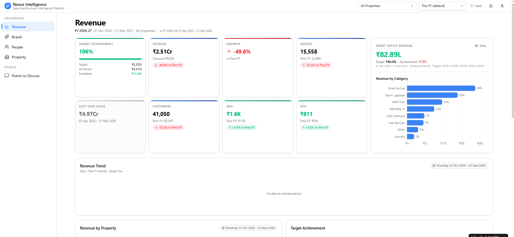
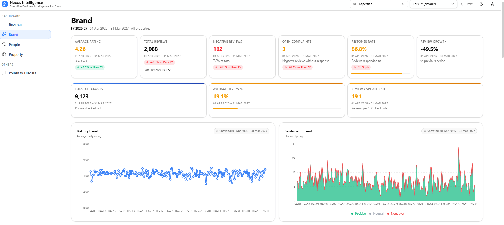
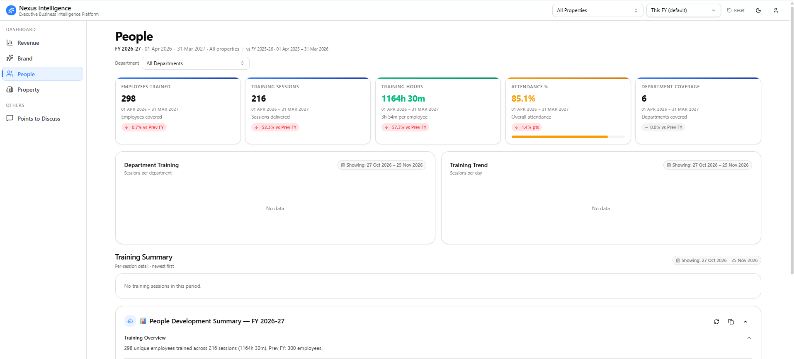
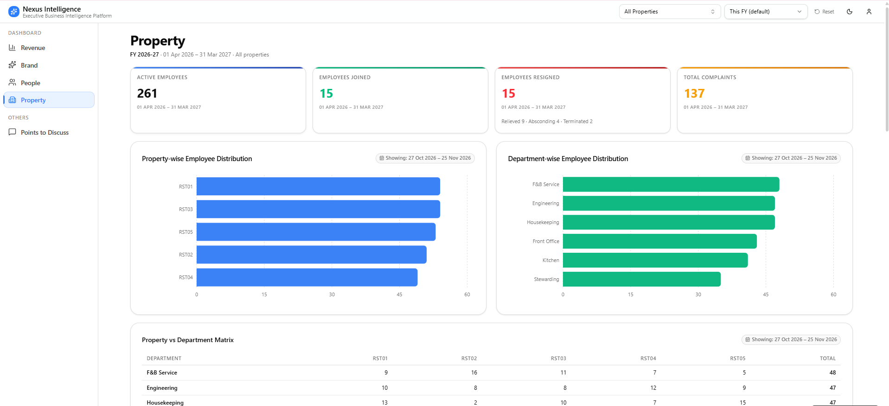

# Hospitality Weekly Insight Hub

### Executive Performance & Operational Intelligence

**One reporting experience for revenue, brand, people and property performance.**

 

  

<a href="#executive-overview">Overview</a> &nbsp;|&nbsp;
<a href="#business-challenge">Challenge</a> &nbsp;|&nbsp;
<a href="#the-solution">Solution</a> &nbsp;|&nbsp;
<a href="#dashboard-experience">Dashboard</a> &nbsp;|&nbsp;
<a href="#key-dashboard-capabilities">Capabilities</a> &nbsp;|&nbsp;
<a href="#my-role-and-contributions">My Role</a> &nbsp;|&nbsp;
<a href="#project-documentation">Documentation</a>

  

<!--
  LIVE DASHBOARD LINK (not yet supplied)
  Insert the correct public URL for Hospitality Weekly Insight Hub (Project 1) below,
  then remove the comment markers around the block.
  Do NOT use the Hospitality Sales & Revenue Intelligence URL; it belongs to a different project.

  
-->

Dashboard preview: Revenue Intelligence

---

## Executive Overview

**Hospitality Weekly Insight Hub** is a centralized business intelligence dashboard that brings revenue, brand experience, workforce and property performance into one weekly reporting view.

It is built for the people who review hospitality performance and decide what happens next:

| Audience | What they use it for |
| :-- | :-- |
| **Leadership and management** | A single view of performance across business functions |
| **Revenue and sales teams** | Revenue trends, targets and upselling insights |
| **Brand and guest experience teams** | Guest ratings, reviews and brand-level performance |
| **HR and people teams** | Workforce information and training attendance |
| **Property teams** | Operational indicators and guest complaint monitoring |

---

## Business Challenge

Hospitality reporting is rarely in one place. Each function tracks its own numbers, and management has to assemble the picture by hand.

- **Fragmented reporting** across business functions
- **Difficulty monitoring performance** consistently from week to week
- **Limited consolidated visibility** across revenue, guest experience, people and properties
- **Challenges comparing** revenue and operational trends side by side
- **A need for management-level reporting** with a clear way to track follow-ups

---

## The Solution

The dashboard consolidates five hospitality perspectives into one structured reporting experience, so a weekly review can move from revenue to guest experience to people to property, and end with agreed actions.

| 1. Revenue | 2. Brand | 3. People | 4. Property | 5. Executive Review |
| :-: | :-: | :-: | :-: | :-: |
| Performance, trends, targets | Ratings and reviews | Workforce and training | Operations and complaints | Discussion points and follow-ups |

Google BigQuery serves as the reporting data source, and the dashboard layer was built with Lovable.

---

## Dashboard Experience

### 1. Revenue Intelligence

Revenue performance, sales trends, targets and upselling insights in one view.

 

### 2. Brand Intelligence

Guest ratings, reviews and brand-level performance.

 

### 3. People Analytics

Workforce information and training attendance.

 

### 4. Property Performance

Property-level operational indicators and guest complaint monitoring.

 

### 5. Executive Review

Management discussion points and follow-up tracking.

---

## Key Dashboard Capabilities

| Capability | What it provides |
| :-- | :-- |
| **Consolidated reporting** | Revenue, brand, people and property views in one place |
| **Performance monitoring** | A regular view of key indicators and trends |
| **Comparative analysis** | Easier comparison of revenue and operational trends |
| **Interactive exploration** | Section-based navigation so reviewers can move to the area they need |
| **Executive visibility** | A management-ready summary with discussion points and follow-up tracking |

---

## My Role and Contributions

This was a **collaborative dashboard development project**. My involvement included:

- Organizing business requirements into meaningful dashboard sections
- Contributing to dashboard development and visual presentation
- Working with reporting requirements across revenue, brand, people and property functions
- Contributing to the integration of Google BigQuery as a reporting data source
- Supporting the presentation of business KPIs, operational trends and management insights
- Helping structure reporting views for easier business performance review

---

## Skills and Tools

---

## Business Value

- **Better visibility** into business performance across functions
- **Easier monitoring** of operational indicators
- **Clearer understanding** of revenue and guest experience trends
- **Workforce and property reporting** in the same review
- **Structured management discussions**, with points to discuss and follow-ups tracked in one place

---

## Project Documentation

| Document | Description |
| :-- | :-- |
| [Architecture](docs/architecture.md) | How the reporting solution is structured |
| [Data Dictionary](docs/data-dictionary.md) | Definitions of the data and fields used |
| [Dashboard Modules](docs/dashboard-modules.md) | The dashboard sections and what each covers |

---

## Data and Privacy

This public portfolio contains **approved demo or sanitized data only**.

It does not disclose:

- Company or employer identity
- Internal project identifiers
- Private BigQuery project or dataset names
- Real guest or employee details
- Credentials or confidential information

---

**Hospitality Analytics | Business Intelligence | Dashboard Development**

Collaborative dashboard development project.

<a href="https://github.com/Nandini-Boda/hospitality-weekly-insight-hub">github.com/Nandini-Boda/hospitality-weekly-insight-hub</a>

