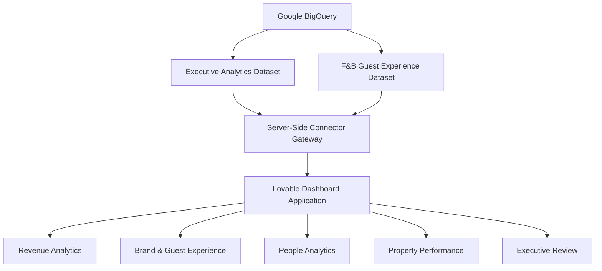

# System Architecture

## 1. Architecture Overview

The Hospitality Weekly Insight Hub follows a centralized analytics architecture in which Google BigQuery serves as the primary data warehouse and Lovable provides the interactive dashboard interface.

The application retrieves structured data from BigQuery through a server-side connector gateway and presents it through five business intelligence modules.

The architecture separates data storage, data access, and dashboard presentation.

## 2. High-Level Architecture

## 3. Technology Layers

### 3.1 Data Storage Layer

Google BigQuery is used as the centralized data warehouse.

The demonstration environment contains two datasets:

**Executive Analytics Dataset**
- F&B sales transactions
- F&B revenue targets
- Item-level sales
- Sales booking information
- Front Office upselling
- Upselling targets
- Training attendance
- HR workforce records
- Guest complaints
- Executive discussion records

**F&B Guest Experience Dataset**
- Guest ratings and review information
- Review platform performance
- Guest feedback metrics

The architecture uses 11 demonstration tables across these datasets.

### 3.2 Data Access Layer

The dashboard communicates with BigQuery through a server-side connector gateway.

The gateway handles dashboard query execution against the configured BigQuery environment.

The application uses the connector gateway rather than directly exposing database credentials in the browser.

### 3.3 Presentation Layer

Lovable is used to build the interactive dashboard application.

The presentation layer organizes business metrics into five modules:

1. Revenue
2. Brand
3. People
4. Property
5. Points to Discuss

Each module presents relevant business indicators and performance information retrieved from the centralized data source.

## 4. Data Flow

The application's data flow follows these stages:

1. Structured demonstration data is stored in BigQuery.
2. Data is organized into two logical datasets.
3. Dashboard queries are submitted through the server-side connector gateway.
4. BigQuery processes the requested queries.
5. Query results are returned to the dashboard application.
6. The dashboard presents the results through interactive visualizations and KPI components.

## 5. Dataset-to-Dashboard Mapping

| Dataset | Dashboard Modules | Data Domain |
|---|---|---|
| Executive Analytics | Revenue | Sales and financial performance |
| Executive Analytics | Brand | Bookings and guest experience |
| F&B Guest Experience | Brand | Guest ratings and reviews |
| Executive Analytics | People | Workforce and training |
| Executive Analytics | Property | HR and operational performance |
| Executive Analytics | Points to Discuss | Executive review tracking |

## 6. Architectural Design Principles

### Centralized Data Access
Business reporting data is accessed from a centralized BigQuery environment instead of relying on separate Google Sheets connections.

### Modular Dashboard Design
Dashboard functionality is organized into independent business modules to improve navigation and reporting clarity.

### Separation of Responsibilities
Data storage, query execution, and dashboard presentation are handled through separate architectural layers.

### Scalable Data Foundation
BigQuery provides a foundation for expanding reporting capabilities and supporting additional analytical requirements.

### Data Privacy
The public portfolio documentation uses generic dataset descriptions and excludes private project identifiers, credentials, and production records.

## 7. Security Considerations

- Database credentials must remain server-side.
- Sensitive connection configurations must never be committed to GitHub.
- Production employee and guest records must not be included in public repositories.
- Public demonstrations should use sanitized datasets.
- Access permissions should follow the principle of least privilege.
- Connector authorization and access controls must be reviewed before deployment.

## 8. Current Architecture Scope

The documented implementation covers:

- Two BigQuery datasets.
- Eleven demonstration tables.
- Five dashboard modules.
- Server-side BigQuery query execution.
- Lovable-based interactive dashboard presentation.

The following implementation details are intentionally not assumed because they have not yet been verified:

- Exact connector authentication mechanism.
- Query caching and refresh strategy.
- Query optimization techniques.
- Frontend framework and component architecture.
- Deployment configuration and environment management.

These details can be documented after reviewing the exported application source code.

## 9. Future Architecture Enhancements

Potential improvements include:

- Automated data-quality monitoring.
- Scheduled KPI alerts.
- Query performance optimization.
- Advanced historical analysis.
- Predictive analytics.
- Role-based dashboard access.
- Expanded business intelligence integrations.

---

**Architecture Stack:** Google BigQuery · Server-Side Connector Gateway · Lovable

*Documentation describes the known implementation and distinguishes verified components from details awaiting source-code inspection.*
